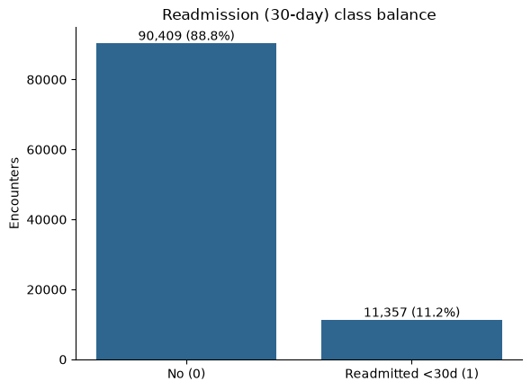
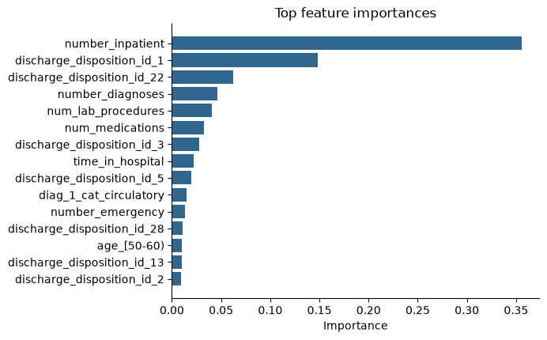

# Predicting 30-Day Hospital Readmission in Diabetes Patients

Predicting whether a diabetic patient will be readmitted to the hospital within 30 days, using the [UCI Diabetes 130-US Hospitals (1999-2008)](https://archive.ics.uci.edu/dataset/296/diabetes+130-us+hospitals+for+years+1999-2008) dataset.

## Result

**Gradient Boosting, ROC-AUC 0.68 vs. a 0.50 "always predict no" baseline — catches 58% of actual 30-day readmissions (recall), up from 0% for the baseline.**

| Model | ROC-AUC | Recall (readmit) | Precision (readmit) |
|---|---|---|---|
| Always "no" (baseline) | 0.500 | 0.000 | 0.000 |
| Logistic Regression | 0.675 | 0.559 | 0.127 |
| Random Forest (`class_weight="balanced"`) | 0.659 | 0.010 | 0.270 |
| **Gradient Boosting** | **0.680** | **0.583** | 0.122 |

Precision is low across the board (~12%) because the positive class is rare (~11% of encounters) — at this recall level the model is intentionally over-flagging to avoid missing readmissions, which is usually the right trade-off for a clinical screening tool (a missed readmission is costlier than an extra follow-up call). Random Forest is the interesting negative result here: `class_weight="balanced"` barely moved its recall, because it reweights impurity during tree-building but doesn't change the 0.5 decision threshold on the vote — Gradient Boosting (via `sample_weight`) and Logistic Regression's linear boundary responded to the imbalance correction much more.




## Problem

Hospital readmissions within 30 days are costly and often considered a signal of poor care continuity. This project frames the original 3-class `readmitted` label (`NO`, `>30`, `<30`) as a **binary classification problem**: did the patient return within 30 days or not. The target class is rare (~11% of encounters), so the project also deals with **class imbalance**.

## Project structure

```
.
├── data/                   # not version controlled — see data/README.md
│   ├── raw/                # original diabetic_data.csv goes here
│   ├── processed/          # cleaned data, written by notebooks/02_preprocessing.ipynb
│   └── external/           # supplementary reference data (e.g. ID mappings)
├── notebooks/
│   ├── 01_eda.ipynb            # missingness, target balance, distributions
│   ├── 02_preprocessing.ipynb  # cleaning + target construction, writes processed/
│   ├── 03_modeling.ipynb       # baseline, logistic regression, RF, gradient boosting
│   └── 04_evaluation.ipynb     # ROC-AUC, confusion matrix, ROC curve, feature importance
├── src/
│   ├── config.py               # paths, random seed, target column name
│   ├── app.py                  # Streamlit demo — type in patient info, get a risk score
│   ├── data/
│   │   ├── load_data.py        # reads raw CSV (handles "?" as NaN)
│   │   └── clean_data.py       # dedup, drop sparse/ID columns, diagnosis grouping, binary target
│   ├── features/
│   │   └── build_features.py   # numeric/categorical preprocessing pipeline
│   ├── models/
│   │   ├── train.py             # train/test split + Random Forest / Gradient Boosting pipelines
│   │   ├── baseline.py          # "always no" dummy baseline + Logistic Regression baseline
│   │   ├── predict.py           # load a saved model and score new data
│   │   ├── evaluate.py          # ROC-AUC, classification report, confusion matrix
│   │   └── explain.py           # feature importance extraction
│   └── visualization/
│       └── visualize.py         # class balance, missingness, confusion matrix, ROC curve, feature importance plots
├── models/                 # saved model artifacts (.joblib), not version controlled
├── reports/figures/        # exported plots
├── tests/                  # unit tests for src/ (pytest)
├── requirements.txt
└── pyproject.toml
```

The intent: **notebooks are for exploration and narrative** (what did I find, what did I decide and why), while **`src/` holds the reusable, tested logic** that notebooks, the Streamlit app, and any future script call into. Nothing important should exist only inside a notebook cell.

## Setup

```bash
python -m venv .venv
.venv\Scripts\activate          # on Windows
pip install -r requirements.txt
pip install -e .                # makes `src` importable as a package
```

Then follow `data/README.md` to download the dataset into `data/raw/`.

## Workflow

Run the notebooks in order: `01_eda` → `02_preprocessing` → `03_modeling` → `04_evaluation`. Each one imports from `src/` rather than redefining logic inline.

Run tests with:

```bash
pytest
```

Run the demo app (after `03_modeling` has produced `models/best_model.joblib`):

```bash
streamlit run src/app.py
```

## Modeling notes — things worth mentioning in an interview

- **Patient-level leakage guard**: the same `patient_nbr` can have many encounters. If two encounters from the same patient land on opposite sides of the train/test split, the model can partly "recognize" that patient rather than generalize, inflating test performance. `drop_duplicate_patients` keeps only the first encounter per patient before splitting.
- **Expired-patient filter**: `discharge_disposition_id` codes 11/19/20/21 mean the patient died during the stay — they cannot be "readmitted," so leaving them in is pure label noise. They're dropped in `clean()`.
- **Coded IDs aren't numbers**: `admission_type_id`, `discharge_disposition_id`, and `admission_source_id` are integer-coded categories (e.g. `1` = "Emergency"), not magnitudes. Left as-is they'd get silently standard-scaled as if "8" were twice "4" — they're explicitly treated as categorical throughout the pipeline (`PSEUDO_CATEGORICAL_COLUMNS` in `build_features.py`), including after a CSV round-trip, which re-infers them as `int64` and would otherwise undo the fix.
- **Diagnosis grouping**: `diag_1/2/3` are raw ICD-9 codes — hundreds of distinct values, too high-cardinality to one-hot usefully. They're bucketed into clinical categories (circulatory, respiratory, digestive, diabetes, injury, musculoskeletal, genitourinary, neoplasms, other), following the standard approach from the dataset's original paper (Strack et al., 2014).
- **Class imbalance**: `class_weight="balanced"` for Random Forest / Logistic Regression; `GradientBoostingClassifier` has no `class_weight` param, so it gets balanced `sample_weight` at fit time instead. As the results above show, this doesn't guarantee a recall improvement (see the Random Forest result) — it's worth validating empirically per model rather than assuming it "just works."
- **ROC-AUC alone is a weak signal under imbalance**: recall and precision are tracked alongside it, since a model can have a decent ROC-AUC while still being useless at the operating threshold that matters.

## Next steps / ideas

- Try SMOTE (via `imbalanced-learn`, already a dependency) and compare against class-weighting.
- Threshold tuning: pick a decision threshold off a precision-recall curve instead of the default 0.5, based on the real cost of a missed readmission vs. an unnecessary follow-up.
- SHAP values for per-patient explanations (the current feature importance is global, not per-prediction).
- Hyperparameter tuning via `GridSearchCV` or `Optuna`.

## Data source & citation

Strack, B., DeShazo, J. P., Gennings, C., Olmo, J. L., Ventura, S., Cios, K. J., & Clore, J. N. (2014). Diabetes 130-US Hospitals for Years 1999-2008 [Dataset]. UCI Machine Learning Repository.
